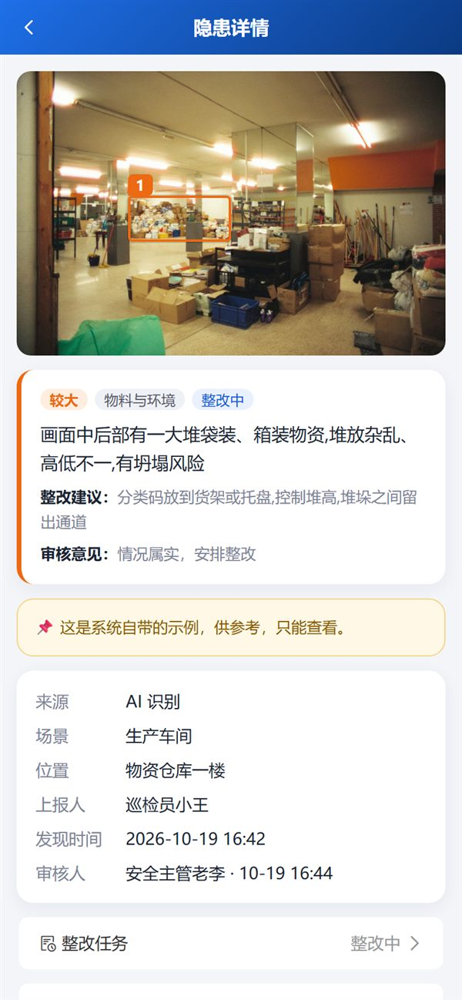
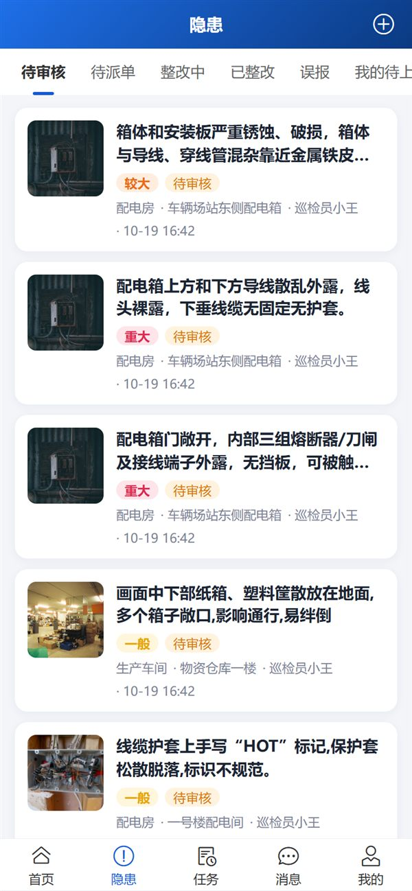
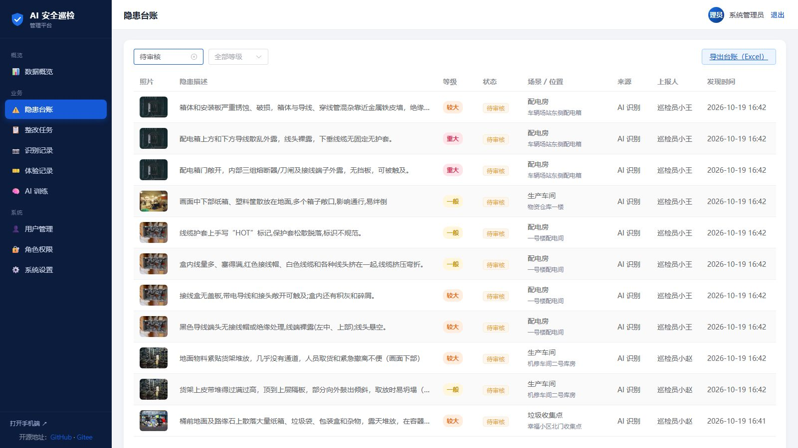
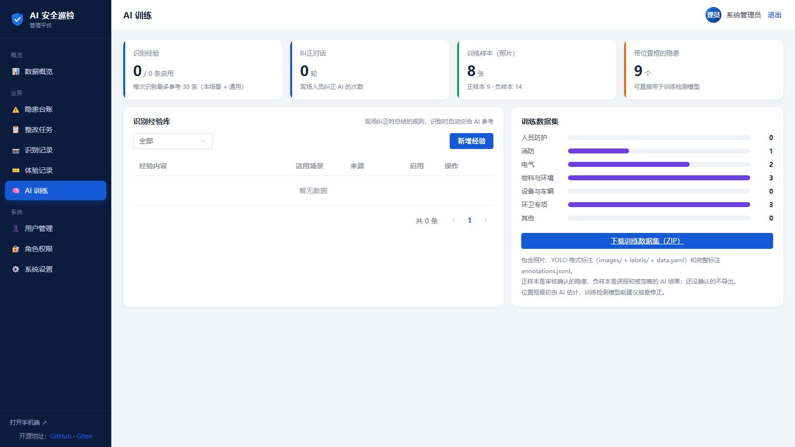

# AI 安全巡检（开源基础版）

安全员用手机拍一张现场照片，多模态大模型找出照片里的安全隐患：在照片上框出位置，标出等级（一般、较大、重大），给出整改建议，看不清的项目提醒补拍。确认后上报，由安全管理员审核。

只用手机浏览器，不用装 App，也不用买摄像头之类的硬件。

## 在线体验

完整版已经部署在线上，可以直接用手机打开体验：

- 手机端：<https://inspection.xiaowuiot.com/>
- 管理后台：<https://inspection.xiaowuiot.com/admin.html>（需要系统管理员账号，不对外开放）

登录页可以一键登录下面三个体验账号，统一密码 `demo2026`：

| 账号 | 角色 | 能做什么 |
|---|---|---|
| `demo_xunjian` | 体验巡检员 | 拍照识别、勾选上报隐患、人工上报 |
| `demo_zhuguan` | 体验安全主管 | 审核隐患、派发整改任务、验收或驳回 |
| `demo_zhenggai` | 体验整改员 | 接收任务、拍照提交整改 |

建议按这个顺序走一遍完整流程：

1. 巡检员登录，选场景拍照，确认识别结果后点"上报审核"
2. 安全主管登录，在"隐患"里确认等级，派发整改任务给体验整改员
3. 整改员登录，在"任务 → 待我处理"里接收任务，拍一张整改后的照片提交
4. 安全主管再登录，在"待我验收"里验收通过，或者驳回让整改员重新提交

不想自己拍，可以在"我的 → 示例数据"里看系统自带的示例：公园、马路、工地、环卫车辆、道路施工、垃圾收集点、配电房等场景的识别结果，以及审核、派单、整改、驳回、验收的完整流程。

体验账号大家共用，数据只在体验账号之间可见，每个账号每天能识别的次数有限。

## 界面截图

截图来自完整版（和线上一样）。开源版包含拍照识别、框出隐患、上报审核这些基础功能，整改闭环、AI 训练等区别见下面的对照表。

| 隐患详情：照片上框出隐患位置 | 隐患列表 |
|---|---|
|  |  |

**管理后台 · 隐患台账**：按状态、等级筛选，导出 Excel



**管理后台 · AI 训练**：现场纠正沉淀成识别经验，审核过的隐患导出成训练数据集（YOLO 格式）



## 开源版和完整版

这个仓库是开源基础版，拉下来就能跑通"拍照 → AI 识别 → 确认上报 → 审核"。

| 功能 | 开源版 | 完整版 |
|---|:---:|:---:|
| 手机拍照识别，照片上框出隐患，给出等级和整改建议 | ✅ | ✅ |
| 识别结果确认后上报、人工上报、审核（确认 / 误报） | ✅ | ✅ |
| 识别记录、删除自己的记录 | ✅ | ✅ |
| 接入 OpenAI 兼容接口的多模态模型（通义千问 VL 等） | ✅ | ✅ |
| 巡检场景 | 3 个 | 9 个（含工地、环卫车辆作业、道路施工等） |
| 整改闭环：派单、按角色接单、整改、验收、驳回、超期提醒 | | ✅ |
| AI 认错了当场纠正：对话纠错、在照片上画圈重标、补拍近景 | | ✅ |
| 经验记忆：纠错总结成规则，以后同类场景自动参考；导出训练数据 | | ✅ |
| 管理后台：数据看板、隐患台账导出、用户和角色权限、经验库、系统设置 | | ✅ |
| 消息提醒、识别额度管理、体验账号、示例数据 | | ✅ |
| 部署方案（Linux / Windows 服务、Nginx、HTTPS、备份） | | ✅ |
| 建表语句、系统讲解文档 | | ✅ |

完整版源码、建表语句和系统讲解文档放在知识星球「小物学长的物联网实战营」里，会按专题讲这个项目是怎么一步步做出来的：<https://t.zsxq.com/hldoY>

## 快速开始

环境：JDK 17+、Maven 3.6+。

```bash
git clone https://github.com/xiaowu-iot/ai-inspection.git
cd ai-inspection
mvn clean package -DskipTests
java -jar target/ai-inspection-0.1.0-SNAPSHOT.jar
```

手机和电脑连同一个局域网，手机浏览器打开 `http://电脑IP:8090/`。

第一次启动会创建管理员账号 `admin`，随机密码写在 `data/initial-admin.txt` 里。登录后在"我的 → 修改密码"里改掉，并删除这个文件。其他人可以自己注册，注册后是"巡检员"角色。

默认用 `mock` 模式：不调用模型，按场景返回固定的演示结果，用来看界面和流程。

## 接入多模态模型

支持任意 OpenAI 兼容接口、能看图的模型。以通义千问为例：

```bash
export INSPECTION_AI_PROVIDER=openai
export INSPECTION_AI_API_KEY=你的 API Key
export INSPECTION_AI_BASE_URL=https://dashscope.aliyuncs.com/compatible-mode/v1
export INSPECTION_AI_MODEL=qwen-vl-max
java -jar target/ai-inspection-0.1.0-SNAPSHOT.jar
```

也可以写在 jar 同目录的 `config/application.yml` 里（这个文件已经在 `.gitignore` 里，不会被提交）：

```yaml
inspection:
  ai:
    provider: openai
    api-key: 你的 API Key
    base-url: https://dashscope.aliyuncs.com/compatible-mode/v1
    model: qwen-vl-max
```

## 配置项

| 配置 | 默认值 | 说明 |
|---|---|---|
| `inspection.data-dir` | `./data` | 数据目录，数据库和照片都在这里 |
| `inspection.ai.provider` | `mock` | `mock` 或 `openai` |
| `inspection.ai.model` | `qwen-vl-max` | 模型名，要支持图片输入 |
| `inspection.ai.timeout-seconds` | `90` | 调用模型的超时时间 |
| `inspection.allow-register` | `true` | 是否开放注册 |
| `inspection.promo` | `true` | "我的"页面是否显示作者公众号和知识星球入口，自己部署时可以关掉 |
| `server.port` | `8090` | 端口 |

## 角色

| 角色 | 权限 |
|---|---|
| 系统管理员 | 全部 |
| 安全管理员 | 拍照识别、上报、审核隐患、查看全部 |
| 巡检员 | 拍照识别、上报隐患（自己注册的用户默认是这个角色） |

## 流程

```
选场景拍照 → AI 识别（待上报，只有拍照人看得到）
          → 拍照人勾选确实存在的隐患，上报审核；没勾选的标为"已忽略"
          → 安全管理员审核：确认（可调整等级）或判定误报
```

照片里看不出来的问题，也可以在"隐患"页右上角人工上报。

## 技术栈

- 后端：Spring Boot 3.5、Spring Data JPA、Spring Security、H2 文件数据库
- 前端：Vue 3 + Vant 4，不需要构建，静态文件直接由后端提供
- 模型：OpenAI 兼容的 `/chat/completions` 接口，一次传一张图，要求模型输出 JSON

```
src/main/java/io/github/xiaowuiot/inspection/
├── ai/          模型接入、提示词、结果解析
├── inspection/  拍照识别、识别记录
├── hazard/      隐患上报、审核
├── scene/       巡检场景和检查清单
├── user/        登录注册、角色权限
├── security/    会话登录
└── photo/       照片存储
src/main/resources/static/   手机端页面
```

## 想系统学、做完整的系统？

这个仓库是**基础版**：拍照识别、确认上报、审核，够你把 AI 识别隐患的流程跑通。

完整版的源码、建表语句和系统讲解文档都在知识星球 **「小物学长的物联网实战营」** 里，整改闭环、AI 纠错、经验记忆、管理后台、部署方案都会按专题讲清楚是怎么一步步做出来的。

👉 加入方式：[知识星球「小物学长的物联网实战营」](https://t.zsxq.com/hldoY)，或者关注公众号「**小物学长**」，回复【星球】。

公众号回复【速查】可以领取《IoT 协议速查手册》PDF。

<p align="center">
  <br>
  微信扫码关注公众号「小物学长」
</p>

其他开源项目：[iot-protocol-gateway](https://github.com/xiaowu-iot/iot-protocol-gateway)（JT/T 808、HJ212 设备接入网关）、[env-monitor](https://github.com/xiaowu-iot/env-monitor)（HJ212 环境在线监测平台）

## 参与贡献

欢迎提交 Issue 和 PR。如果你有识别效果不好的场景照片（请去掉人脸、车牌等敏感信息后再提交），对改进提示词帮助很大。

## 许可证

[AGPL-3.0](LICENSE)。修改后对外提供服务需要按 AGPL 开放源码；想闭源商用，可以通过公众号联系获取商业授权。
